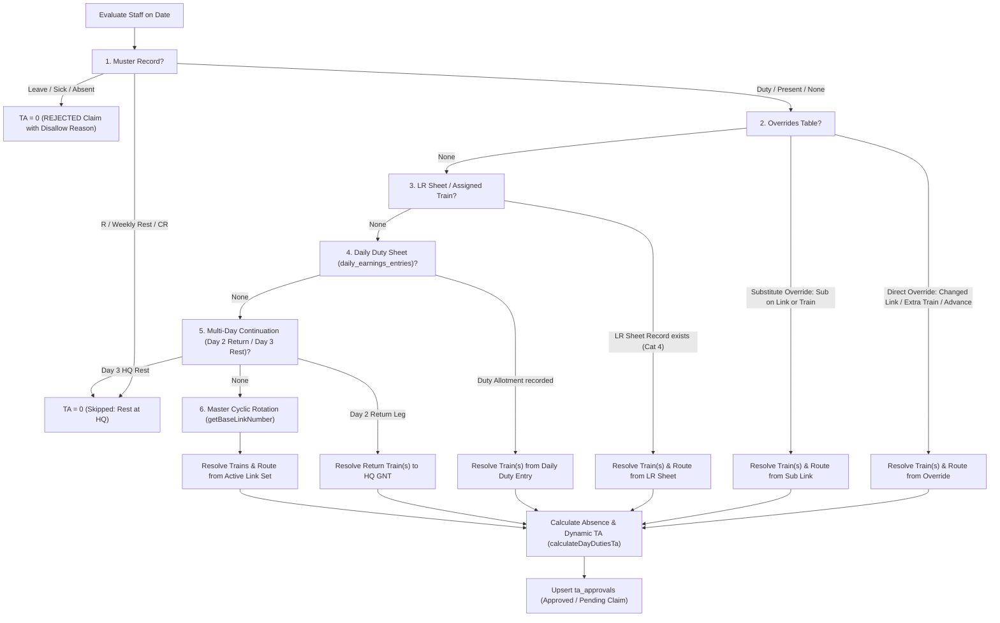

# Railway Roster Management — Comprehensive Technical Reference Manual
**System:** Railway Staff Link-Rotation & Roster Manager  
**Scope:** Universal Up-To-Date Datapoints Architecture & TA Linked to Employee Daily Duties  
**Author:** Antigravity AI Assistant  
**Date:** October 20, 2026  

---

## Table of Contents
1. [Executive Summary](#1-executive-summary)
2. [Module 1: Leave Reserve (LR) List & Link Set Reconciliation](#2-module-1-leave-reserve-lr-list--link-set-reconciliation)
   - [Problem Analysis & Root Cause](#problem-analysis--root-cause)
   - [Functions & Logic Implemented](#functions--logic-implemented)
   - [Detailed Code Annotations](#detailed-code-annotations)
3. [Module 2: Traveling Allowance (TA) Linked Directly to Employee Daily Duties](#3-module-2-traveling-allowance-ta-linked-directly-to-employee-daily-duties)
   - [Daily Duty Hierarchy & Unified Resolution](#daily-duty-hierarchy--unified-resolution)
   - [Backend Functions & Implementation Details](#backend-functions--implementation-details)
   - [Automated Multi-Module Synchronization](#automated-multi-module-synchronization)
4. [Module 3: Universal Up-To-Date Datapoints Architecture](#4-module-3-universal-up-to-date-datapoints-architecture)
   - [Business Rule: Strict Up-To-Date vs Full-Month Estimation](#business-rule-strict-up-to-date-vs-full-month-estimation)
   - [Night Duty Allowance (NDA) Journal & Points](#night-duty-allowance-nda-journal--points)
   - [EFT Diary & Travel Log Statement](#eft-diary--travel-log-statement)
   - [Employee Monthly Earnings Breakdown](#employee-monthly-earnings-breakdown)
   - [Muster Roll Grid & Individual Muster Document](#muster-roll-grid--individual-muster-document)
5. [Database Impact & Maintenance Operations](#5-database-impact--maintenance-operations)
6. [Future Maintenance & Troubleshooting Guide](#6-future-maintenance--troubleshooting-guide)

---

## 1. Executive Summary

This manual serves as the primary technical specification for three core architectural subsystems:
1. **LR List Reconciliation & React Key Stabilization**: Resolving React duplicate key errors (`LRList.tsx:1669`) caused by multi-schedule link set revisions in the database, and ensuring only active link versions are rendered.
2. **TA Linked to Employee Daily Duties**: Ensuring that every employee's Traveling Allowance (TA) is strictly driven by their real daily duty—whether designated via Cyclic Roster Link, Direct Override, Substitute Assignment, LR Sheet Allotment, Multi-Day Return Service, or Daily Duty Sheet (`daily_earnings_entries`).
3. **Universal Up-To-Date Datapoints Architecture**: Enforcing a strict "Up to Date" calculation policy across all employee reports, documents, and totals for the ongoing month (TA, NDA, Diary, Staff Monthly Earnings, Muster Grid, and Individual Muster). Future days in the current month and future months are never estimated.

---

## 2. Module 1: Leave Reserve (LR) List & Link Set Reconciliation

### Problem Analysis & Root Cause
In [`LRList.tsx`](file:///C:/Users/kompa/.gemini/antigravity/scratch/roster-manager/src/frontend/src/LRList.tsx), the duty allotment modal displayed a grid of regular links filtered from `linksList`. Each link card was keyed as:
```tsx
key={`${l.category_id}_${l.link_number}`}
```

#### Why Duplicate Keys Occurred:
In the MySQL database `railway_roster.links`, link revisions exist across multiple effective date intervals (e.g., `effective_from: '2026-07-01'` to `'2026-09-30'` alongside new link sets effective from `'2026-10-01'`).
When querying all published links without filtering by date, Category 2 (Sleeper) returned two records for every link number (`1` through `55`):
- Link Set 2 (Expired: `2026-07-01` to `2026-09-30`)
- Link Set 7 (Active: `2026-10-01` to `9999-12-31`)

React received pairs of children with identical keys (`2_1`, `2_2`, ..., `2_55`), triggering console warnings and unstable DOM updates.

### Functions & Logic Implemented

#### 1. Deduplication and Effective Date Filtering
In [`LRList.tsx`](file:///C:/Users/kompa/.gemini/antigravity/scratch/roster-manager/src/frontend/src/LRList.tsx):
- **Function/Hook:** `filteredAvailableLinks = useMemo(...)`
- **Logic:**
  1. Filters out draft links (`status !== 'draft'`) and rest links (`is_rest !== 1`).
  2. Enforces date-window validity against the currently selected allotment date (`selectedDate`):
     ```ts
     (!l.effective_from || l.effective_from <= selectedDate) &&
     (!l.effective_to || l.effective_to >= selectedDate)
     ```
  3. Uses a `Map<number, Link>` keyed by `link_number` to retain only the most recent active revision.
  4. Keys JSX elements uniquely with a fallback:
     ```tsx
     key={`link-${l.id || `${l.category_id}_${l.link_number}`}`}
     ```

#### 2. Upgrade to COR Modal Key Stabilization
In [`UpgradeToCorModal.tsx`](file:///C:/Users/kompa/.gemini/antigravity/scratch/roster-manager/src/frontend/src/UpgradeToCorModal.tsx):
- Dropdown options were keyed by `l.link_number`, which clashed when multiple link revisions were loaded.
- Updated option key: `key={l.id || l.link_number || idx}`.

---

## 3. Module 2: Traveling Allowance (TA) Linked Directly to Employee Daily Duties

### Daily Duty Hierarchy & Unified Resolution

Every employee's daily duty on any date (`dateStrIso`) is evaluated according to the following strict hierarchy:



### Backend Functions & Implementation Details

#### 1. [`generatePendingTaClaimsForMonth`](file:///C:/Users/kompa/.gemini/antigravity/scratch/roster-manager/src/backend/ta_generator.ts)
- **Role:** Generates or updates all pending/approved claims for an entire month in `ta_approvals`.
- **Enhancements Implemented:**
  - **Category 4 (LR Staff):** Checks `lrEntry.duty_code`, `directOverride` (link number, extra train, advance train, reason), `subOverride` (substitute link or train), and `earnEntry.duty`. LR staff who work substitute links or daily train allotments receive full, accurate TA claims.
  - **Categories 1, 2, 3 (Regular Staff):** Checks `directOverride`, `subOverride` (when the staff member is a substitute on another column's train), and `earnEntry.duty` (when assigned via Daily Duty Sheet).
  - **Leave Disallowance:** When marked on leave in Muster or Overrides, a `REJECTED` claim with `claim_amount: 0` is registered with remark `Disallowed: On Leave/Absent as per Daily Duty (${leaveCode})`.
  - **Rest Skipping:** When marked on rest (`R`, `REST`, `CR`), the day is skipped (no TA claimed).

#### 2. [`generateStaffTaJournal`](file:///C:/Users/kompa/.gemini/antigravity/scratch/roster-manager/src/backend/ta_generator.ts)
- **Role:** Generates individual employee TA Journal documentation.
- Automatically synchronizes with live daily duties via `generatePendingTaClaimsForMonth` before outputting rows.

#### 3. Automated Multi-Module Synchronization
When an administrator edits or assigns a daily duty anywhere in the application:
- `POST /api/duty/change-status` (Duty status edit, substitute assignment, leave mark)
- `POST /api/duty/drag-assign-train` (Drag-and-drop train assignment)
- `POST /api/duty/assign-non-daily-train` (Non-daily train assignment)
- `POST /api/overrides` (Override upsert)
- `POST /api/daily-earnings` (Saving Daily Duty Sheet)
- `POST /api/muster/update-cell` & `POST /api/muster/batch-update` (Muster roll changes)
- `POST /api/lr-sheet/sync-from-daily-duty` (LR sheet synchronization)

All endpoints execute `syncDutyChangeAcrossAllModules` / `generatePendingTaClaimsForMonth`, immediately synchronizing downstream TA claims.

---

## 4. Module 3: Universal Up-To-Date Datapoints Architecture

### Business Rule: Strict Up-To-Date vs Full-Month Estimation
For the ongoing current month (e.g., October 2026), all statistics, totals, and document rows **MUST reflect up-to-date duties only** (duties performed from month start up to today's date). Future dates must not be estimated. For future months (e.g., November 2026), no claims or estimations are pre-generated.

| Datapoint / Report | Previous Behavior | Updated "Up-To-Date" Behavior |
| :--- | :--- | :--- |
| **TA Approvals & Claims** | Estimated all 31 days | Clamped to `todayIso`; future dates omitted |
| **TA Journal Document** | Generated rows for 31 days | Clamped: `actualEnd = todayIso` |
| **NDA Journal (Night Hours)** | Generated rows for 31 days | Clamped: `actualEnd = todayIso`; sum only up to date |
| **Diary Statement (EFTs)** | Generated rows for 31 days | Clamped: `actualEnd = todayIso`; totals up to date |
| **Staff Monthly Earnings** | Generated 31 days (`total_days: 31`) | `maxDay = currentDay`; `total_days: maxDay`; sums up to date |
| **Muster Roll Grid** | Present/Duty counts counted 31 days | `counts` & `grandTotals` count only `d.dateStr <= todayIso` |
| **Individual Muster Document** | Attendance summary counted 31 days | Attendance counts (`P`, `R`, `Leave`) only count `<= todayIso` |

### Night Duty Allowance (NDA) Journal & Points
- **File:** [`src/backend/nda_generator.ts`](file:///C:/Users/kompa/.gemini/antigravity/scratch/roster-manager/src/backend/nda_generator.ts)
  - `generateStaffNdaJournal`: Clamps `actualEnd` to `todayIso` for ongoing months. If `isFutureMonth`, returns `rows: []` and `total_night_hours: 0`.
  - Links to daily duties via `directOverride`, `subOverride`, `lrEntry`, and `earnEntry`.
- **File:** [`src/frontend/src/NdaDocument.tsx`](file:///C:/Users/kompa/.gemini/antigravity/scratch/roster-manager/src/frontend/src/NdaDocument.tsx)
  - `computePresetDates`: Sets `effectiveMonthEnd = todayIso` when `isCurrentMonth`.
  - Preset button displays `Up-to-Date (Prev 30th – {now.getDate()}th)`.

### EFT Diary & Travel Log Statement
- **File:** [`src/backend/diary_generator.ts`](file:///C:/Users/kompa/.gemini/antigravity/scratch/roster-manager/src/backend/diary_generator.ts)
  - `generateStaffDiary`: Clamps `actualEnd` to `todayIso` for ongoing months. If `isFutureMonth`, returns `rows: []` and zeroed `totals`.
  - Links duties to `earnEntry`, `subOverride`, and overrides.
- **File:** [`src/frontend/src/DiaryDocument.tsx`](file:///C:/Users/kompa/.gemini/antigravity/scratch/roster-manager/src/frontend/src/DiaryDocument.tsx)
  - `computePresetDates`: Clamped to `todayIso` for ongoing months.

### Employee Monthly Earnings Breakdown
- **File:** [`src/backend/daily_earnings_generator.ts`](file:///C:/Users/kompa/.gemini/antigravity/scratch/roster-manager/src/backend/daily_earnings_generator.ts)
  - `generateStaffMonthlyEarnings`:
    ```ts
    const maxDay = isCurrentMonth ? Math.min(daysInMonth, currentDay) : (isFutureMonth ? 0 : daysInMonth);
    ```
    - Loops only `for (let dayNum = 1; dayNum <= maxDay; dayNum++)`.
    - `total_days` set to `maxDay`.
    - `duty_days_count`, `rest_days_count`, `active_earnings_days`, and financial sums calculated strictly up to date.
    - Future months return `days: []` and zeroed `totals`.

### Muster Roll Grid & Individual Muster Document
- **File:** [`src/backend/services/muster.service.ts`](file:///C:/Users/kompa/.gemini/antigravity/scratch/roster-manager/src/backend/services/muster.service.ts)
  - `getMusterGrid`: Attendance counts (`P`, `R`, `CR`, `CL`, `LAP`, etc.) and `grandTotals` only increment when `d.dateStr <= todayIso`. Future scheduled dates are flagged with `isFuture: true` and excluded from completed attendance summaries.
- **File:** [`src/frontend/src/IndividualMusterDocument.tsx`](file:///C:/Users/kompa/.gemini/antigravity/scratch/roster-manager/src/frontend/src/IndividualMusterDocument.tsx)
  - Attendance summary counters (`pCount`, `rCount`, `crCount`, `leaveCount`, `sickCount`, `odCount`, `absentCount`) only increment for cells where `c.date <= todayIso`.

---

## 5. Database Impact & Maintenance Operations

### Schema & Tables Affected
- **`ta_approvals`**: Purged 1,302 premature claims (`duty_date > 2026-10-20`). Contains strictly valid duties up to date.
- **`ta_entries`**, **`nda_entries`**, **`diary_entries`**: Date ranges constrained to `actualStart` through `todayIso` during automated generation.
- **`daily_earnings_entries`**: Monthly queries constrained to `maxDay`.

---

## 6. Future Maintenance & Troubleshooting Guide

1. **Adding New Datapoints or Document Types:**
   - Always apply the `isCurrentMonth ? Math.min(daysInMonth, currentDay) : daysInMonth` clamping idiom.
   - For individual document generators, set `actualEnd = isCurrentMonth ? todayIso : monthEnd`.
2. **Duty Resolution Verification:**
   - If an employee's TA or NDA does not match expectations on a given date, verify whether an entry exists in `overrides`, `lr_sheet_records`, or `daily_earnings_entries` for that `staff_id` and `date`.
3. **Backend Service Reload:**
   - Node process runs via `npx tsx src/backend/server.ts`. When editing backend files, stop the existing process before relaunching to bind port 5000 cleanly.
